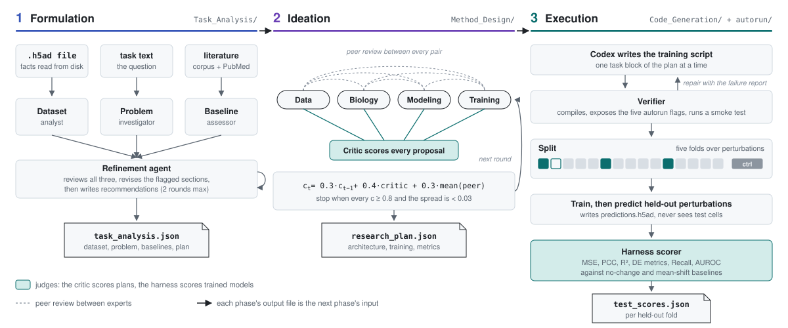
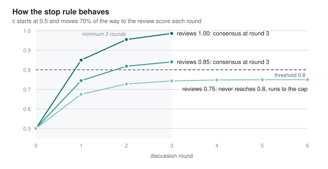
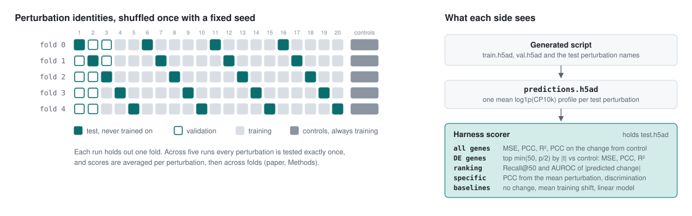

# CellForge

CellForge is a multi-agent system that takes a single-cell perturbation dataset and a research question and returns a trained model with a score on perturbations it has never seen. It was introduced by Tang et al. in [*CellForge: Agentic Design of Virtual Cell Models*](https://arxiv.org/abs/2508.02276) from the Gerstein Lab at Yale. This repository is a rewrite of [gersteinlab/CellForge](https://github.com/gersteinlab/CellForge) in which each phase now consumes the previous phase's output, and every model is scored on held-out perturbations with the metric definitions from the paper's Methods.

[Paper](https://arxiv.org/abs/2508.02276) &nbsp;·&nbsp; [Results in the paper](docs/RESULTS.md) &nbsp;·&nbsp; [Datasets](docs/DATASETS.md) &nbsp;·&nbsp; [GPU benchmark plan](docs/EXPERIMENTS.md)

<picture>
  <source media="(prefers-color-scheme: dark)" srcset="figs/pipeline-dark.svg">
  
</picture>

## How it works

### Formulation

The code is in `cellforge/Task_Analysis`. The dataset file is opened in backed mode and summarized: the perturbation column, the control labels, the number of perturbations and cells per perturbation, the modality and any cell line or organism annotation. Literature comes from a local PDF corpus plus PubMed, Crossref and Semantic Scholar, and every passage keeps an evidence ID. A dataset analyst, a problem investigator and a baseline assessor each write one section of the analysis, and a refinement agent reviews the three together, revises only the sections it flagged, stops early when it has nothing left to fix, and writes recommendations for the model designer.

### Ideation

The code is in `cellforge/Method_Design`. A team of four experts (data engineering, single-cell biology, deep learning, training) is extended with specialists an LLM picks for the task. In each round every expert drafts or revises a proposal, a critic scores all proposals in one call, and each expert reviews the others. Each expert's coordination score follows the update in the paper,

$$c_t = 0.3\,c_{t-1} + 0.4\,\text{critic}_t + 0.3\,\overline{\text{peer}}_t ,$$

with reviews bounded to [0.1, 1.0] and every score starting at 0.5. The discussion stops once every score is at least 0.8 and no two differ by 0.03 or more. The critic then writes up the top-ranked proposal as the research plan, applying its open review points, and the other proposals are dropped, as the paper describes. If that call fails, the saved plan says so in its `plan_source` field.

<picture>
  <source media="(prefers-color-scheme: dark)" srcset="figs/coordination-dark.svg">
  
</picture>

Because the score moves 70% of the way toward the current reviews in each round, the 0.8 threshold amounts to requiring reviews that average at least 0.8. Reviews that settle at 0.75 never reach it, and the discussion runs to its cap, which is six rounds by default and up to the paper's twenty through `METHOD_DESIGN_MAX_ROUNDS`. In the other direction, a first round in which every review is 0.93 or higher ends the discussion before any expert has revised anything; `METHOD_DESIGN_MIN_ROUNDS` sets a minimum for anyone who wants to test whether revision helps.

### Execution

The code is in `cellforge/Code_Generation` and `cellforge/autorun`. The Codex CLI writes a training script for each task block of the plan. A verifier compiles it and checks that its `--help` lists the five flags the runner passes, and failures go back to Codex as a structured report for a bounded number of repairs. The runner then trains the script on one fold of the data, locally or through Slurm, and scores its predictions.

## Evaluation

<picture>
  <source media="(prefers-color-scheme: dark)" srcset="figs/evaluation-dark.svg">
  
</picture>

The split and the metrics follow the paper. Perturbation identities are shuffled once with a fixed seed and divided into five folds, and each run holds one fold out for testing, so a model is always scored on perturbations it did not train on. Control cells stay in training because every prediction is made relative to them. The generated script receives the training and validation files and the names of the test perturbations, and writes one predicted mean profile (log1p of counts per 10k) per test perturbation to `predictions.h5ad`. Test expression stays with the harness.

For each held-out perturbation, `cellforge/autorun/scoring.py` compares mean profiles and reports MSE, PCC and R² over all genes, PCC on the change from control, and the same three metrics over the observed differentially expressed genes. That set is the top min(50, ⌊p/2⌋, p−1) genes by absolute t statistic against control cells, following Scanpy's `t-test_overestim_var`. It also reports Recall@50, the overlap between the observed set and the 50 genes with the largest predicted change, and the AUROC of the predicted change for membership in that set. The same metrics are computed for two reference predictors on the same perturbations, no change from control and the average shift seen across training perturbations, because a model that cannot beat the mean shift has not learned anything perturbation-specific. Scores are averaged per perturbation, and then across folds.

## Results reported in the paper

These numbers come from the paper and were produced with the authors' original pipeline, not with this rewrite. Each row is a model that CellForge designed for that dataset.

| Dataset | Setting | Designed model | Reported outcome |
|---|---|---|---|
| Adamson 2016 | CRISPRi, scRNA-seq | CPA-X | highest PCC of all methods (0.9883); DE error above the best reference methods |
| Norman 2019 | CRISPRa, single and paired | scGen-X | lowest MSE on DE genes (0.1736) |
| Srivatsan 2020 | small molecules and doses | ChemCellFlow | second to CellFlow, which was built for this dataset |
| Schiebinger 2019 | cytokine-driven differentiation | CPA-Traj | first on several global and DE metrics against generic baselines |
| Papalexi 2021 | CRISPR, CITE-seq RNA and protein | totalGAT | lowest MSE for RNA and protein; protein recovery weaker than RNA |
| Liscovitch-Brauer 2021 | CRISPR, scATAC-seq | ChromDDPM | lower overall; ahead of simple baselines on several metrics |

In a blinded comparison of research plans against OpenAI, Perplexity and Gemini Deep Research, Biomni and a single-LLM baseline, CellForge had the highest mean score in 14 of 15 task and criterion combinations. The five LLM judges agreed with each other at r = 0.88 to 0.93, and human expert scores followed those judges more closely than CellForge's own discussion confidence, which correlated with the experts at r = 0.53. [docs/RESULTS.md](docs/RESULTS.md) has the architectures, cost, and the review of failed runs.

## Quick start

```bash
git clone https://github.com/sahielbose/CellForge && cd CellForge
pip install -e .
cp .env.example .env                      # one LLM key is enough
npm install -g @openai/codex && codex login

python scripts/download_datasets.py adamson
cellforge --init && cellforge --doctor

DATA=data/datasets/AdamsonWeissman2016_GSM2406681_10X010.h5ad
cellforge --dataset-path $DATA            # formulation, ideation, code generation
for k in 0 1 2 3 4; do cellforge --phase autorun --dataset-path $DATA --fold $k; done
```

Each phase can also run alone with `--phase task_analysis`, `method_design`, `code_generation` or `autorun`. For a cluster, add `--executor slurm` with `--partition`, `--gres`, `--mem`, `--slurm-time` and `--conda-env`, then score the finished jobs with `python -m cellforge.autorun.scoring <run folder>`. Any OpenAI-compatible endpoint works through `CUSTOM_API_URL`, and `MODEL_NAME` selects the provider by its prefix. Outputs go to `data/analyses`, `data/plans`, `data/discussion`, `data/codes` and `data/runs`.

## Changes from the upstream code

The original repository had the three phases, but several of them did not pass their results on. Each change below was checked against upstream commit `6585ff9`.

| Upstream behavior | This version |
|---|---|
| `_generate_final_proposal` returned the initial template (the same transformer plan for every dataset), and the expert discussion was only written to a log | the plan is synthesized from the discussion, and a failed synthesis is labeled `template_fallback` |
| every dataset was described to the agents as K562, CRISPRi, scRNA-seq; analysts returned invented defaults (10,000 cells, 2,000 genes) when an LLM call failed | the dataset file is read, and a failed call is reported as an error |
| Method Design kept keyword hits from the Task Analysis report and dropped its content | the full report reaches every expert |
| the consensus score was the first decimal number in the critique text, shared by all experts | each expert gets critic and peer scores and the paper's update rule |
| held-out perturbations were never scored; the only metric was the generated script's own number on a random cell split of training perturbations, and the control label could land in the held-out set | five perturbation folds, controls kept in training, scoring done by the harness with the paper's metrics and two baselines |
| TLS verification was disabled for DeepSeek, Llama, Qwen and custom endpoints, prompts were logged, and generated code ran with API keys in its environment | verification on, no prompt logging, secrets removed from the environment of generated code |
| `temperature=0` became 0.7, reasoning models rejected `max_tokens`, and chat calls kept only the last user message | fixed |

Unused code went with it: the legacy RAG system, the OpenHands backend, the Node SDK runner, about 2,000 lines of expert persona text that nothing read, and several agent variants. The Python went from 20,345 lines to 5,630, and the tests cover the split, the scorer, the discussion arithmetic, refinement, the hand-off between phases and an autorun round trip.

## Repository layout

```
main.py                       command line (the `cellforge` entry point)
cellforge/dataset.py          reads perturbation, control and modality facts from an .h5ad
cellforge/llm.py              one client for OpenAI, Anthropic, DeepSeek, Llama, Qwen and custom endpoints
cellforge/retrieval/          local corpus plus PubMed, Crossref and Semantic Scholar, with evidence IDs
cellforge/Task_Analysis/      three analysts, the refinement agent, the report
cellforge/Method_Design/      expert pool, graph discussion, plan synthesis
cellforge/Code_Generation/    Codex backend, verifier, repair loop
cellforge/autorun/            five-fold split, local and Slurm runs, scoring
scripts/download_datasets.py  the six benchmark datasets from scPerturb, checksum-verified
```

## Citation

```bibtex
@article{tang2025cellforge,
  title   = {CellForge: Agentic Design of Virtual Cell Models},
  author  = {Tang, Xiangru and Yu, Zhuoyun and Chen, Jiapeng and Cui, Yan and
             Shao, Daniel and Wang, Weixu and Wu, Fang and Zhuang, Yuchen and
             Shi, Wenqi and Huang, Zhi and Cohan, Arman and Lin, Xihong and
             Theis, Fabian and Krishnaswamy, Smita and Gerstein, Mark},
  journal = {arXiv preprint arXiv:2508.02276},
  year    = {2025},
  url     = {https://arxiv.org/abs/2508.02276}
}
```

GitHub's citation button reads the same entry from [`CITATION.cff`](CITATION.cff). The code is released under the MIT license.
