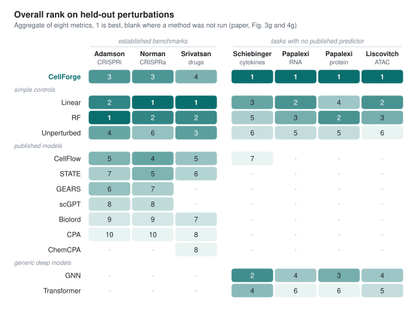
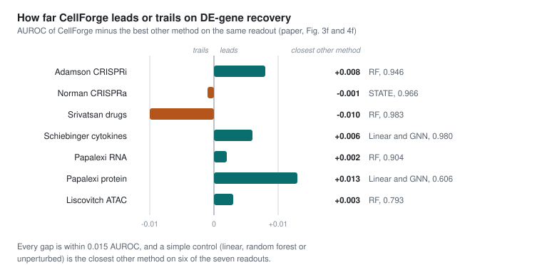

# Results

Everything on this page up to the last section is taken from the CellForge manuscript ([arXiv:2508.02276](https://arxiv.org/abs/2508.02276)), and the figure numbers refer to its current revision. The authors produced these results with their original pipeline, which ran code through OpenHands, so none of them were made with this repository. The last section shows how to build the same page from your own runs, and [EXPERIMENTS.md](EXPERIMENTS.md) describes the full comparison.

## Protocol

CellForge was evaluated on six perturbation datasets with seven held-out readouts, since the Papalexi CITE-seq data is scored separately for RNA and for surface protein. Perturbation identities were split into five folds, every method was scored only on held-out perturbations, and each CellForge result is a mean over three independent runs of the full design, implementation and training cycle. Metrics are computed per held-out perturbation from mean profiles and then averaged, first over perturbations and then over folds. The differentially expressed set for each perturbation is the top 50 genes from `scanpy.tl.rank_genes_groups`, using `t-test_overestim_var` for the established scRNA-seq benchmarks and the Wilcoxon test for the multimodal ones, and Recovery@50 and AUROC measure how well the predicted change ranks those genes.

On the three established benchmarks, the figures compare CellForge with STATE, CPA, Biolord, GEARS, scGPT and CellFlow on genetic perturbations, with ChemCPA added for drugs, and with unperturbed, random-forest and linear-regression controls, all on the same folds. The other four readouts have no published task-specific predictor, so CellForge was compared with the same three controls, a graph neural network and a Transformer, and with CellFlow on Schiebinger.

The scorer in this repository uses the same definitions. It ranks the DE set by the `t-test_overestim_var` statistic unless `CELLFORGE_DE_TEST=wilcoxon` is set, which matches the paper's choice for the Papalexi and Liscovitch-Brauer readouts.

## Rankings

<picture>
  <source media="(prefers-color-scheme: dark)" srcset="../figs/ranks-dark.svg">
  
</picture>

Each cell is a method's overall rank on one readout, which the paper aggregates over eight metrics: PCC, MSE and R² on mean profiles, the same three on the DE genes, Recall and AUROC. Linear regression and random forest lead all three established benchmarks, and CellForge places third, third and fourth, ahead of every published model on each of them. On the four newer readouts it ranks first, with the controls and the GNN as the closest competitors.

<picture>
  <source media="(prefers-color-scheme: dark)" srcset="../figs/auroc-margin-dark.svg">
  
</picture>

The margins are small. On the AUROC of DE-gene recovery CellForge leads on five readouts and trails on two, and its largest lead, on Papalexi protein, is 0.013. Figures 3f and 4f show these values without error bars, so the page cannot tell whether differences of this size exceed run-to-run variation.

<details>
<summary>AUROC of DE-gene recovery for every method (Figures 3f and 4f)</summary>

<br>

| Method | Adamson | Norman | Srivatsan | Schiebinger | Papalexi RNA | Papalexi protein | Liscovitch ATAC |
|---|---:|---:|---:|---:|---:|---:|---:|
| **CellForge** | **0.954** | 0.965 | 0.973 | **0.986** | **0.906** | **0.619** | **0.796** |
| Linear | 0.941 | 0.963 | 0.981 | 0.980 | 0.902 | 0.606 | 0.792 |
| Random forest | 0.946 | 0.962 | **0.983** | 0.974 | 0.904 | 0.595 | 0.793 |
| Unperturbed | 0.919 | 0.926 | 0.977 | 0.953 | 0.883 | 0.490 | 0.627 |
| CellFlow | 0.927 | 0.952 | 0.980 | 0.960 | | | |
| STATE | 0.935 | **0.966** | 0.955 | | | | |
| GEARS | 0.940 | 0.952 | | | | | |
| scGPT | 0.934 | 0.935 | | | | | |
| Biolord | 0.881 | 0.903 | 0.754 | | | | |
| CPA | 0.937 | 0.934 | 0.779 | | | | |
| ChemCPA | | | 0.775 | | | | |
| GNN | | | | 0.980 | 0.871 | 0.606 | 0.785 |
| Transformer | | | | 0.958 | 0.771 | 0.570 | 0.734 |

A blank cell means the method was not run on that readout. The `figs/` versions of both figures are generated from these values by `scripts/make_figures.py`.

</details>

## Where the text and the figures disagree

Three statements in the manuscript's text do not match its own figures, and the figures are what this page reports.

| The text says | The figures show |
|---|---|
| CPA-X has the highest PCC of all methods on Adamson, 0.9883 | Figure 3g ranks CellForge fourth on PCC on Adamson, behind random forest, linear regression and the unperturbed control |
| scGen-X has the lowest MSE on DE genes on Norman, 0.1736 | Figure 3g ranks CellForge fifth on DE-gene MSE on Norman, behind linear regression, random forest, CellFlow and the unperturbed control |
| the reference methods for genetic perturbations were CPA, scGen, CondOT, Biolord and scGPT | Figures 3f and 3g have no scGen or CondOT, and include STATE, GEARS and CellFlow |

The text also places ChemCellFlow second to CellFlow on Srivatsan, while Figure 3g ranks CellForge fourth overall and CellFlow fifth; CellFlow is ahead on AUROC (0.980 against 0.973), so the text may refer to a subset of metrics. Earlier versions of the README and of this page repeated the first two claims from the text.

## The designed models

Each model below is the architecture CellForge produced for one dataset, described as the paper describes it. All of them have between 10 and 30 million parameters. The ranks and AUROC values come from Figures 3 and 4.

| Model | Dataset | Architecture | Rank and AUROC |
|---|---|---|---|
| CPA-X | Adamson, CRISPRi | MLP expression encoder with a multi-head cross-attention block in which the perturbation embedding attends to the encoded control state; related to scGen and CPA | third of 10 overall; AUROC 0.954, the highest on this dataset |
| scGen-X | Norman, CRISPRa singles and pairs | bottlenecked expression encoder, cross-attention that fuses perturbation identity with cell context, residual MLP decoder; resembles GEARS and AttentionPert | third of 10 overall; AUROC 0.965, second to STATE at 0.966 |
| ChemCellFlow | Srivatsan, drugs and doses | gene and chemical encoders conditioned on compound and dose, a Sinkhorn conditional optimal-transport block, and a normalizing flow (six flow layers in the supplementary code); closest to CellFlow | fourth of 9 overall; AUROC 0.973, against 0.983 for random forest |
| CPA-Traj | Schiebinger, cytokine-driven differentiation | trajectory-aware VAE with shared and condition-specific latents, a continuous time covariate, a perturbation-mixing module and an MLP decoder | first of 7 overall; AUROC 0.986 |
| totalGAT | Papalexi, CITE-seq | modality-specific encoders, graph attention, cross-attention with perturbation embeddings, and separate RNA and protein heads | first of 6 for RNA and for protein; AUROC 0.906 for RNA and 0.619 for protein |
| ChromDDPM | Liscovitch-Brauer, scATAC-seq | DDPM-style denoiser: a two-stage MLP bottleneck on baseline accessibility, sinusoidal step and perturbation conditioning, a four-block residual MLP with noise and accessibility heads, and an auxiliary head that reconstructs the perturbation | first of 6 overall; AUROC 0.796, against 0.793 for random forest; the paper calls it a plausible adaptation of diffusion, not a validated chromatin architecture |

## Research plans

Plans from CellForge were compared with plans written from the same task specification by OpenAI Deep Research, Perplexity Deep Research, Gemini Deep Research, Biomni and a single-LLM prompting baseline, with system identities hidden. Five LLM judges (Claude 3.7, DeepSeek-R1, OpenAI o1, Qwen-2.5 and Llama 3.1) scored each plan from 1 to 10 for scientific validity, technical feasibility, innovation, experimental design and impact potential. CellForge had the highest mean score in 14 of 15 task and criterion combinations, and the exception was technical feasibility on the drug task, where OpenAI Deep Research scored higher. Pairwise correlations among the judges ranged from 0.88 to 0.93.

Three single-cell biologists also rated the plans blind, on criteria that include biological plausibility, mechanism explanation, pathway relevance and generalization across perturbations, and they favored CellForge in most but not all combinations. Their scores tracked the LLM judges more closely than CellForge's internal coordination score, which correlated with the experts at r = 0.53. The paper takes this as support for LLM judges in plan-level comparison, and as evidence that deliberation confidence cannot stand in for external evaluation.

## Cost

The paper reports these token counts as illustrative ranges per run, not audited totals.

| Phase | Simple task, prompt | Simple task, completion | Complex task, prompt | Complex task, completion |
|---|---:|---:|---:|---:|
| Task preparation | 15,000 | 50,000 | 25,000 | 100,000 |
| Research ideation | 20,000 | 100,000 | 40,000 | 200,000 |
| Experiment execution | 5,000 | 50,000 | 15,000 | 100,000 |
| Total | 40,000 | 200,000 | 80,000 | 400,000 |

Models were trained through Slurm on the Yale misha and bouchet clusters, one GPU per job with a one-day wall-time limit, and each repair or retraining round was a new job. A run typically finished in four to eight hours once scheduled, mostly spent training.

## Failed runs

<picture>
  <source media="(prefers-color-scheme: dark)" srcset="../figs/failure-modes-dark.svg">
  
</picture>

The authors reviewed 20 failed executions by hand. Running and repairing code accounts for 80% of the reported shares, while hallucinated structures or outputs, the failure most often expected from a language model, account for 4%. The paper used this profile to add tensor-shape tracing and stricter type checks to the repair step. Most of these failures happen after a design already exists, which is why the experiments in [EXPERIMENTS.md](EXPERIMENTS.md) begin by closing the loop in the execution stage.

## Measuring this version

After the autorun jobs for a dataset finish, one command turns them into a page in the same shape as the tables above.

```bash
python -m cellforge.autorun.scoring data/runs/<dataset>/<run folder>      # only for Slurm jobs, once they finish
python -m cellforge.autorun.report data/runs --out docs/RESULTS-measured.md
```

The report has one table per dataset with every metric as a mean and standard deviation over trained models and folds, next to the linear, mean-shift and no-change predictors scored on the same perturbations, and a per-fold table under it. It also counts the folds in which the designed model beat the mean shift on PCC_delta, which is the first thing to check. No runs from this repository have been measured yet; Stage 0 of [EXPERIMENTS.md](EXPERIMENTS.md) gets the reference numbers on a CPU in a few minutes.
