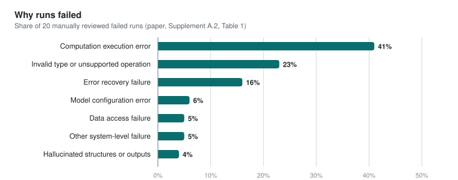

# Results reported in the paper

Everything on this page is taken from the CellForge manuscript ([arXiv:2508.02276](https://arxiv.org/abs/2508.02276)), and the section names refer to its current revision. The authors produced these results with their original pipeline, which ran code through OpenHands, so none of them were made with this repository. [EXPERIMENTS.md](EXPERIMENTS.md) describes how to measure this version against them.

## Protocol

CellForge was evaluated on six perturbation datasets with seven held-out readouts, since the Papalexi CITE-seq data is scored separately for RNA and for surface protein. Perturbation identities were split into five folds, every method was scored only on held-out perturbations, and each CellForge result is a mean over three independent runs of the full design, implementation and training cycle. Metrics are computed per held-out perturbation from mean profiles and then averaged, first over perturbations and then over folds. The differentially expressed set for each perturbation is the top 50 genes from `scanpy.tl.rank_genes_groups`, using `t-test_overestim_var` for the established scRNA-seq benchmarks and the Wilcoxon test for the multimodal ones, and Recovery@50 and AUROC measure how well the predicted change ranks those genes.

For the three established benchmarks the reference methods were CPA, scGen, CondOT, Biolord and scGPT for genetic perturbations, and ChemCPA and CellFlow for drugs, alongside unperturbed, random-forest and linear-regression controls, all reproduced on the same folds. The other three datasets have no published task-specific predictor, so CellForge was compared with linear regression, random forest, a graph neural network and a Transformer trained under the same protocol.

The scorer in this repository follows the same definitions with one simplification: it ranks genes by the `t-test_overestim_var` statistic for every readout, including the multimodal ones where the paper used the Wilcoxon test.

## The designed models

Each model below is the architecture CellForge produced for one dataset, described as the paper describes it. All of them have between 10 and 30 million parameters.

| Model | Dataset | Architecture | Outcome |
|---|---|---|---|
| CPA-X | Adamson, CRISPRi | MLP expression encoder with a multi-head cross-attention block in which the perturbation embedding attends to the encoded control state; related to scGen and CPA | highest PCC of all methods, 0.9883, but a higher DE error than the best reference methods |
| scGen-X | Norman, CRISPRa singles and pairs | bottlenecked expression encoder, cross-attention that fuses perturbation identity with cell context, residual MLP decoder; resembles GEARS and AttentionPert | lowest MSE on DE genes, 0.1736 |
| ChemCellFlow | Srivatsan, drugs and doses | gene and chemical encoders conditioned on compound and dose, a Sinkhorn conditional optimal-transport block, and a normalizing flow (six flow layers in the supplementary code); closest to CellFlow | second best, behind CellFlow, which was developed and tuned for this dataset |
| CPA-Traj | Schiebinger, cytokine-driven differentiation | trajectory-aware VAE with shared and condition-specific latents, a continuous time covariate, a perturbation-mixing module and an MLP decoder | first on several global and DE metrics |
| totalGAT | Papalexi, CITE-seq | modality-specific encoders, graph attention, cross-attention with perturbation embeddings, and separate RNA and protein heads | lowest MSE for both RNA and protein and better RNA DE correlation than the generic baselines, which stayed competitive on some global correlations; protein recovery weaker than RNA |
| ChromDDPM | Liscovitch-Brauer, scATAC-seq | DDPM-style denoiser: a two-stage MLP bottleneck on baseline accessibility, sinusoidal step and perturbation conditioning, a four-block residual MLP with noise and accessibility heads, and an auxiliary head that reconstructs the perturbation | lower than the expression tasks overall, ahead of simple baselines on several metrics; the paper calls it a plausible adaptation of diffusion, not a validated chromatin architecture |

## Research plans

Plans from CellForge were compared with plans written from the same task specification by OpenAI Deep Research, Perplexity Deep Research, Gemini Deep Research, Biomni and a single-LLM prompting baseline, with system identities hidden. Five LLM judges (Claude 3.7, DeepSeek-R1, OpenAI o1, Qwen-2.5 and Llama 3.1) scored each plan from 1 to 10 for scientific validity, technical feasibility, innovation, experimental design and impact potential. CellForge had the highest mean score in 14 of 15 task and criterion combinations, and the exception was technical feasibility on the drug task, where OpenAI Deep Research scored higher. Pairwise correlations among the judges ranged from 0.88 to 0.93.

Three single-cell biologists also rated the plans blind, on criteria that include biological plausibility, mechanism explanation, pathway relevance and generalization across perturbations, and they favored CellForge in most but not all combinations. Their scores tracked the LLM judges more closely than CellForge's internal coordination score, which correlated with the experts at r = 0.53. The paper takes this as support for LLM judges in plan-level comparison, and as evidence that deliberation confidence cannot stand in for external evaluation.

## Cost

The paper reports these token counts as illustrative ranges per run, not audited totals.

| Phase | Simple task, prompt | Simple task, completion | Complex task, prompt | Complex task, completion |
|---|---:|---:|---:|---:|
| Task preparation | 15,000 | 50,000 | 25,000 | 100,000 |
| Research ideation | 20,000 | 100,000 | 40,000 | 200,000 |
| Experiment execution | 5,000 | 50,000 | 15,000 | 100,000 |
| Total | 40,000 | 200,000 | 80,000 | 400,000 |

Models were trained through Slurm on the Yale misha and bouchet clusters, one GPU per job with a one-day wall-time limit, and each repair or retraining round was a new job. A run typically finished in four to eight hours once scheduled, mostly spent training.

## Failed runs

<picture>
  <source media="(prefers-color-scheme: dark)" srcset="../figs/failure-modes-dark.svg">
  
</picture>

The authors reviewed 20 failed executions by hand. Running and repairing code accounts for 80% of the reported shares, while hallucinated structures or outputs, the failure most often expected from a language model, account for 4%. The paper used this profile to add tensor-shape tracing and stricter type checks to the repair step. Most of these failures happen after a design already exists, which is why the experiments in [EXPERIMENTS.md](EXPERIMENTS.md) begin by closing the loop in the execution stage.
